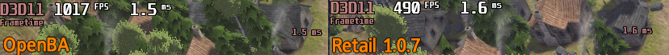

# OpenBA: An open source reimplentation of Banished's Engine  
<p align="left">

</p>

---

OpenBA aims to rebuild Banished as a open source, readable, C++ codebase.    
This project is designed along the lines of OpenRCT2, divilutionX etc where the aim is    
to have baseline parity with the game's 1.0.7 release, but allowing for under the hood changes that still match retial.  
The project is designed to drop into the game's directory and run, and uses no game assets or code.  
Optional extensions are supported (see below).  

Project goals: readable C++ with classes, decent comments, and no "function is byte identical" slop.  
The engine also supports basic multithreading, higher performance, and various rendering fixes.  
OpenBA delivers a sharp experience even on 4k displays,  
and the ability to hit 140fps+ at 50x speed with over 2k citizens. (Tested on a 5080/9800x3d)    
<p align="left">  
  
</p>  
With AO and MSAA enabled on 10x, OpenBA  (left) performs 100fps better than retail (right) on the same map (2k citizen stress test)

---  

> **NOTE: You need your own copy of Banished.**  
> OpenBA has no game assets, shaders, sounds, models or .rsc resource files.  
> At a baseline it needs the retail 1.0.7 `WinData/*.pkg` packages.  
> Grab a zip from releases, extract it to your banished folder, then run OpenBA's executable.  
> The GOG and Steam versions should both work for data.  

## Project status

- **Functionality:** OpenBA boots, loads retail saves, and has a working 1:1 simulation of the base game.
- **Verification:** OpenBA has a full unit test suite verified against the retail games behavior.
- **Platforms:** Windows x64 10/11 (DirectX 11), Linux x64 (Vulkan 1.3) and macOS arm64 (Metal), built
  with CMake and GCC 16 (Windows: the pinned WinLibs build, release exe profile-guided).

## Versioning

The main menu's build line shows retail's version on the left and OpenBA's on the right, e.g.
retail: `1.0.7 17Se10` OpenBa: `OpenBA v1.0.0 2424a9093 2026-10-19`:

- **`1.0.7` and `17Se10`** are retail's. `1.0.7` is the game version OpenBA targets.    
   `17Se10` is retail's build stamp.    
- **`OpenBA vX.Y.Z`** is this project's release version: the `VERSION` in `CMakeLists.txt`  
  (`project(banished_reimpl VERSION X.Y.Z ...)`), compiled in as `OPENBA_VERSION`.     
  Releases are tagged `v<version>` in git (ie `v1.0.0`) and the zip on the releases page matches the tag.    
- **`2424a9093 2026-10-19`** is the git commit the exe was built from and the build date (UTC).  

A release bumps the CMake `VERSION`, adds its section to `CHANGELOG.md` and pushes the tag `v<version>`;   
the Release workflow (`.github/workflows/release.yml`) then builds the Windows zip, the Linux tarball and the   
macOS app zip and publishes them under the "Releases" link with that section as the notes.  

## Extensions

Extensions can be enabled in the new **Extensions** button in the main menu.

Types:  
**Fixes**   Base game bugs: Issues in the base game that are logical or programming errors.  
**Class A** Basic functionality: Performance, graphics, and basic gameplay changes.  
**Class B** Advanced/Divergent functionality: Agreessive performance modifications, breaks from base game behavior.  
Fixes default **on**; non-gameplay changing class A extensions default **on**, class B extensions default **off**

Extensions include performance tweaks, graphical enhancements, and bug fixes for the base game.  
(i.e. Advanced graphics settings can be found in the **Enhanced** tab of Options).  
For a list of extensions see: [docs/extensions/LIST.md](docs/extensions/LIST.md).  
For extension design see: [docs/extensions/DESIGN.md](docs/extensions/DESIGN.md).  

## Building
Prerequisites on Windows:
the pinned WinLibs GCC 16.2 (`tools/toolchain/install_winlibs.sh`), MSYS2 for its shell, CMake 3.20+ and Ninja.
OpenBA also requires Python 3, and the game installed.

```bash
git clone --recurse-submodules https://github.com/fran-cap/untitled_rev_eng_project
cd untitled_rev_eng_project
export BANISHED_DIR="C:/GOG Games/Banished" # your install; this is the default
tools/build.sh unit # OPTIONAL: build + run the unit tests (needs the install for a few)
tools/build.sh run # build, deploy into BANISHED_DIR and launch a new game
```

`tools/build.sh` is what runs the show:  
(`build | unit | deploy | run | run-menu | stress | clean`, build type: `debug | og | perf | release`).  
The deploy step copies `OpenBA.exe` and required resources to the game's folder.  
More setup info, the Linux stuff, and the debugger setup are in [docs/reference/environment.md](docs/reference/environment.md).  

## Code Layout

| Path | Desc |
|---|---|
| `src/game/` | Game logic: components, dialogs, AI, tools |
| `src/engine/` | Engine runtime: objects, I/O, UI, audio, math |
|,`src/platform/` | Win32 and POSIX seams |
| `src/render/dx11/` | Dx11 renderer |
| `src/ext/` | Fixes and extensions |
| `src/app/`, `src/diag/` | Launcher and the diagnostics / harness code |
| `tests/unit/` | Unit tests; `tools/` the build, gate, capture and analysis scripts |
| `docs/` | Design, status and reference; `/history/` has the full development history |
| `third_party/` | SDL3 (submodule), Dear ImGui, FFmpeg's WMA v2 decoder (LGPL), ASSAO sources (MIT) |

## How it was made

The retail binaries were decompiled with Ghidra and rewritten function by function into  
C++, with binary-compatible class layouts so saves and the game's own data files load unchanged.  
The whole process, is recorded under `docs/` if you want to peruse.  
Most of the code was written with AI agents (Claude mostly) under human direction and review.  

## Legal

OpenBA is an independent project with no affiliation to or endorsement by Shining Rock  
Software. Banished is their work and their trademark. This repository holds only OpenBA's own  
source code and documentation. There is no game content and no copies of the retail binaries.  
OpenBA is not designed for profit, the project is designed as an engineering exercise.  
If you are the rights holder and have a concern, please open an issue or reach out to me.  

**License:** OpenBA is free software under the **GNU General Public License v3.0**   
([LICENSE](LICENSE); full list: [THIRD_PARTY_NOTICES.md](THIRD_PARTY_NOTICES.md)). The vendored third-party code keeps its own licence: SDL3 (zlib),  
Dear ImGui (MIT), ASSAO (MIT), the FFmpeg WMA v2 decoder (LGPL 2.1+) and FreeType 2.13.3 (the  
FreeType License; portions copyright (c) The FreeType Project, www.freetype.org), all GPL-compatible.  

**Typeface:** the user-interface typeface is **FrancophilSans** by Manfred Klein (1932-2018), used  
under his "Simple Terms of Use": free for private and commercial use, with a donation to  
[Doctors Without Borders](https://www.msf.org/) asked for when a use makes a profit.   
The two `.ttf` files are kept unchanged under `tools/release/fonts/` and ship beside `OpenBA.exe`   
in the release package (with `FrancophilSans_README.txt`), are loaded privately by the exe when the face   
is not installed, and are not part of OpenBA's code or of its GPL-3.0 licence.  
